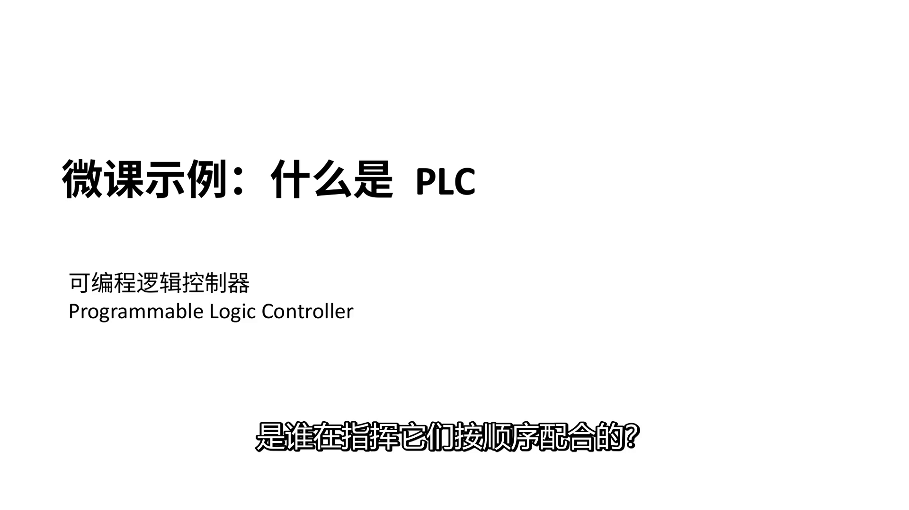
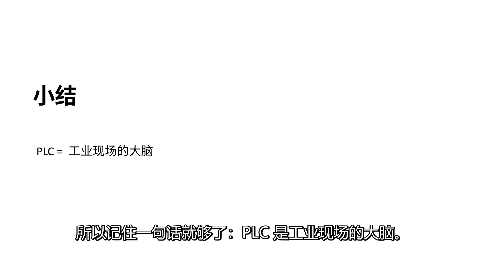

# PPT 转微课视频（ppt-to-microcourse-video）

把一份 PPT 变成**能直接发给学生的讲课视频**：每页配讲解旁白、字幕烧进画面，输出一个 MP4。
不需要剪辑软件，不需要配音，不花钱，不上传云端。

适合：微课录制、培训视频、知识点讲解、把旧课件翻新成视频课。

> **English**: turn a slide deck into a narrated teaching video — script, free Edge TTS,
> word-accurate burned-in subtitles, Ken Burns motion, one H.264 MP4. Plain Python +
> ffmpeg + edge-tts, no API key and no cloud upload, so it runs inside any coding agent
> (Codex / Claude Code / Cursor / Gemini CLI / DSH) or from a shell.

▶ **[看 31 秒成片](https://github.com/sukida678/ppt-to-microcourse-video/releases/download/v0.1.0/demo.mp4)** — 2 MB，`examples/demo.pptx` 跑出来的完整一条（中文旁白 + 烧入字幕 + 运镜）。




上面两张就是那条片子的截图（`--motion none`，所以画面不裁边）。
字幕是按真实发音时间对齐的，不是按字数均分。

---

## 怎么用（三步，全程让 AI 干）

**第 1 步：拿到这份 skill**

```bash
git clone https://github.com/sukida678/ppt-to-microcourse-video.git   # 或在页面上 Code → Download ZIP
```

也可以直接解压压缩包到一个目录，例如 `D:\tools\ppt-to-microcourse-video`。
路径里有中文也行（已专门回归过中文路径），英文更省事。

想先看效果，不用自己的课件：

```bash
python install.py
python scripts/make_course.py extract --deck examples/demo.pptx --work build
copy examples\narration.example.json build\narration.json    # Windows
cp   examples/narration.example.json build/narration.json    # macOS / Linux
python scripts/make_course.py build --work build
```

三页 PLC 示例，约 30 秒出片，产物在 `build/course.mp4` 和 `build/course.srt`。

**第 2 步：把你的 PPT 放进去，然后对 AI 说一句话**

把 PPT 文件（比如 `第1课 Python简介.pptx`）放进这个文件夹，然后在 Codex / Claude Code /
Cursor / DSH 里**打开这个文件夹**，把下面这句发给它：

> 读 AGENTS.md，然后把这个文件夹里的 `第1课 Python简介.pptx` 做成微课视频。
> 讲稿要口语化，不要念 PPT 上的字。做好后告诉我时长和文件在哪。

**第 3 步：等它给你视频**

AI 会自己检查环境、拆页面、写讲稿、配音、合片、抽查画面，最后告诉你：

> 10 分 03 秒 · 27.5 MB · 1920×1080 · 41 页 · 197 条字幕

视频默认在 `build/course.mp4`，字幕在 `build/course.srt`。

---

## 它会自动做什么

1. **检查电脑**：Python、ffmpeg、LibreOffice、配音组件，缺什么直接告诉你安装命令
2. **拆 PPT**：每页导成 2000×1125 的高清图，并抽出每页的文字和备注
3. **写讲稿**：这是最关键的一步。**不是把 PPT 上的字念一遍**，而是像老师站在讲台上那样讲
   ——开头抛问题、中间解释原理、结尾总结要点。每页 15–30 秒
4. **配音**：微软 Edge 的免费中文语音（默认女声·晓晓），语速可调
5. **配字幕**：按真实发音时间对齐，烧进画面；另存一份 `.srt` 备用
6. **合片**：1920×1080 或 4K，H.264，微信/钉钉/学习平台都能直接播
7. **自检**：抽帧看字幕有没有压住内容、画面有没有被切边，不合格会自己重做

---

## 想改点什么，也只要说一句

| 你说 | 它做 |
|---|---|
| "换男声" | 换成云希（`zh-CN-YunxiNeural`） |
| "讲慢一点" | 语速 `-8%`，适合要跟着操作的课 |
| "画面别动" | 关掉运镜，整页稳定显示 |
| "压到 6 分钟" | 讲稿改提纲式，不逐条展开 |
| "分成两集" | 按章节拆成两个短视频 |
| "加背景音乐" | 垫在旁白下面，自动压低音量 |
| "字幕挡字了" | 给字幕加半透明底条 |

---

## 电脑上需要装的东西

AI 会自动检查并告诉你缺哪个，这里只是备查：

| 组件 | 作用 | 安装 |
|---|---|---|
| Python 3.9+ | 跑脚本 | python.org |
| ffmpeg | 合成视频 | Windows `winget install Gyan.FFmpeg` · macOS `brew install ffmpeg` · Linux `sudo apt install ffmpeg`（或 `dnf`） |
| LibreOffice | 把 PPT 转成图片 | Windows `winget install TheDocumentFoundation.LibreOffice` · macOS `brew install --cask libreoffice` · Linux `sudo apt install libreoffice-impress` |
| 三个 Python 包 | 拆页 / 配音 / 读讲稿备注 | `pip install edge-tts pymupdf python-pptx` |

一条命令全查：`python scripts/doctor.py --fix`（退出码 0 = 你手上这类输入能出片；加 `--strict` 则要求 `.pptx` 全流程可用，缺 LibreOffice 就返回 1）

**没装 LibreOffice 也能用**：把它另存成 PDF，然后按 PDF 处理。

---

## 常见问题

**Q：一定要联网吗？**
要。配音用的是微软 Edge 的在线语音服务（免费、不用注册）。断网时只能做无声幻灯片。

**Q：PPT 里的动画会保留吗？**
不会。每一页当成一张静态图处理 —— 视频的节奏靠讲稿和运镜，不靠 PPT 动画。
如果你的 PPT 页面之间有动画分步，建议先按动画拆成多页再转。

**Q：能做英文课吗？**
能。`--voice en-US-AriaNeural` 换英文声音，讲稿用英文写即可。

**Q：视频有多大？**
10 分钟大约 30 MB（1080p）。要更小就 `--resolution 1280x720`。

**Q：字被切掉了 / 字幕压住内容了？**
把截图发给 AI，说"这里被切了"。对应的开关是 `--motion none`（不裁边）和 `--sub-box`
（字幕加底条），AGENTS.md 第 4 节有完整对照表。

---

## 目录结构

仓库里就这些（21 个文件，克隆下来即可用）：

```
ppt-to-microcourse-video/
├── SKILL.md               ← 技能定义（Claude Code / DSH 的 skill 入口）
├── AGENTS.md              ← 给 AI 看的操作手册（Codex / Cursor / DSH 都读，权威版）
├── CLAUDE.md              ← 同上的指针文件
├── README.md              ← 你正在看的这份
├── PROMPTS.md             ← 可以直接复制给 AI 的话术
├── install.py             ← 一键检查/安装依赖
├── LICENSE                ← MIT
├── .gitignore             ← 忽略 build/、*.mp4、__pycache__
├── .gitattributes         ← 统一换行；图片 / PPT 按二进制存
├── scripts/
│   ├── doctor.py          ← 环境体检
│   ├── make_course.py     ← 主程序：extract / build / all
│   ├── ppt2png.py         ← PPT / PDF → 图片
│   ├── tts_edge.py        ← 配音 + 字幕时间轴
│   └── compose.py         ← 合成视频
├── references/            ← 讲稿写法、后端选择、排错手册
├── docs/                  ← README 里的两张成片截图
└── examples/
    ├── demo.pptx          ← 三页示例 PPT，可以先拿它试
    └── narration.example.json
```

跑起来之后**只会往 `--work` 指定的目录里写东西**（下面以 `build/` 为例，这些不进仓库）：

```
build/
├── png/slide_01.png …     ← 每页导出的图（150 dpi 约 2000×1125）
├── slides.json            ← 每页的标题、要点、备注
├── narration.json         ← 讲稿（AI 写的，你必须改掉模板）
├── audio/  sub/  parts/   ← 配音 mp3、逐页字幕、分段视频
├── course.mp4             ← 成片
└── course.srt             ← 整片字幕（备用，不受 --subs 影响）
```

---

## 许可

MIT。随便用、随便改、商用也可以，保留版权声明即可。
